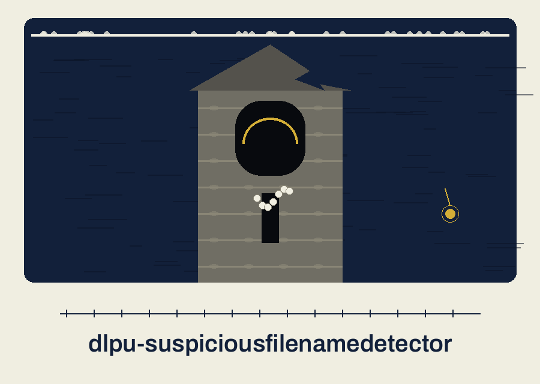
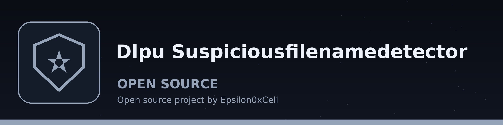

# dlpu-suspiciousfilenamedetector

Title block: the name above is set in Bruno Ace SC in bone white on abyss indigo, with a gauge tick rule beneath it and a small gauge image at the left of major headings, plain ruled headings at minor ones, following the theme heading treatment.

# dlpu-SuspiciousFilenameDetector
Analyzes filenames in a directory and flags files with names that resemble sensitive data (e.g., containing 'SSN', 'creditcard', 'confidential') using regular expressions and a configurable keyword list.  Outputs a report of potentially sensitive files. It does not read file contents, redact anything, or scan logs or network traffic: it judges only the final name component, by case-insensitive substring match against the built-in seven keywords or a custom list that replaces them.

> Sounding note: contents are never read, only names. The program looks at the names of files in one directory and never opens a file.

## Install
`git clone https://github.com/ShadowGuard-AI/dlpu-suspiciousfilenamedetector`

## Usage
`python3 main.py directory [options]`

> Sounding note: subfolders are never entered. The scan covers one level only, the names sitting directly in the directory given.

## Parameters
- `directory`: The directory to analyze.
- `-h`: Show help message and exit
- `-k`, `--keywords`: Custom keywords to search for, one or more, replacing the built-in seven outright.
- `-o`, `--output`: Output file for report (optional).

> Sounding note: custom keywords replace the built in seven rather than adding to them. One custom word switches all seven built in checks off for that run.

> Sounding note: a flagged entry is reported by its full path although only its final name component was judged. A keyword in a folder name above the file contributes nothing.

## License
This project is released under the MIT License. See the [LICENSE](LICENSE) file for details.

## Soundings, gathered at the tower

The buttons of this re-skin read Check These Names, Save the List, and Read the Soundings. Its headings read Names, Not Contents, One Folder Deep, Your Words Replace Ours, and Paths, Reported Whole. Two facts are entered once more at full size: supplying custom keywords replaces the built in set outright, and the repository LICENSE file carries the MIT License, its holder line giving a pen name together with a single initial for the remaining name.
